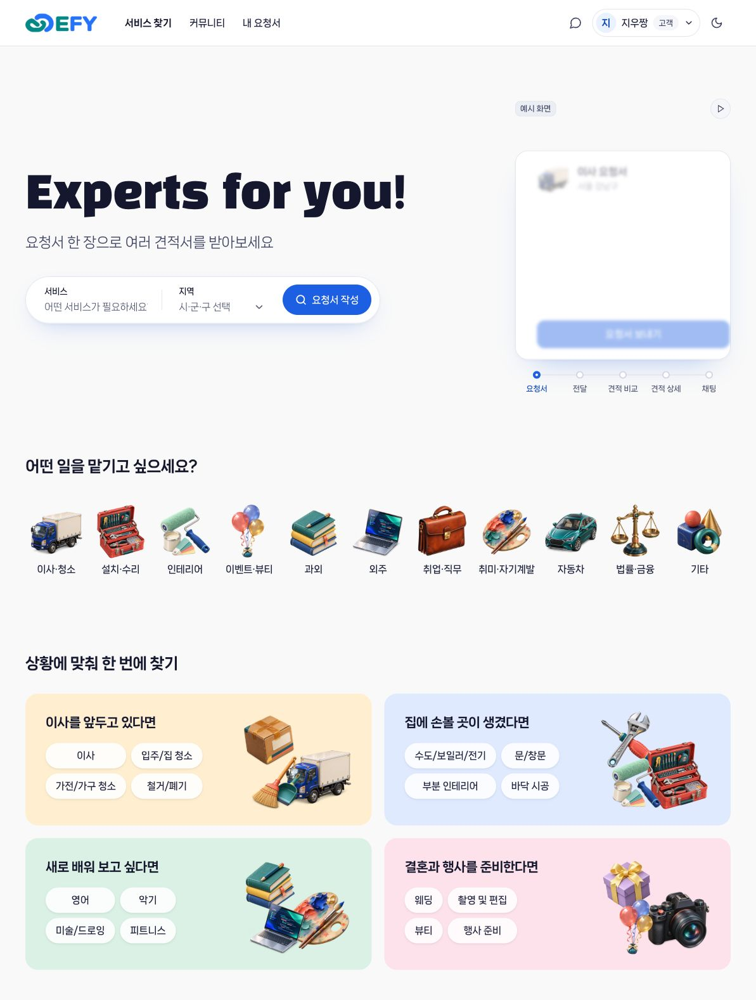
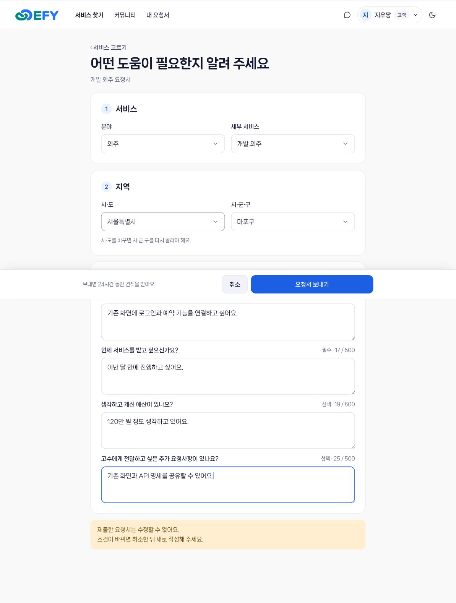
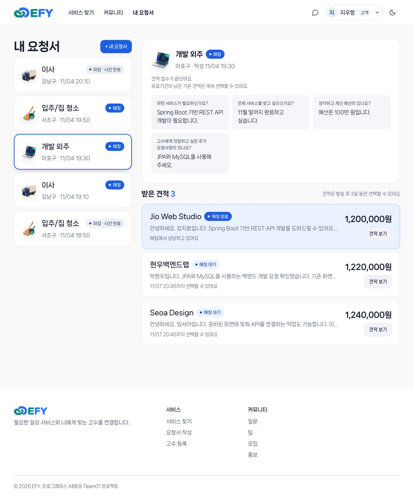
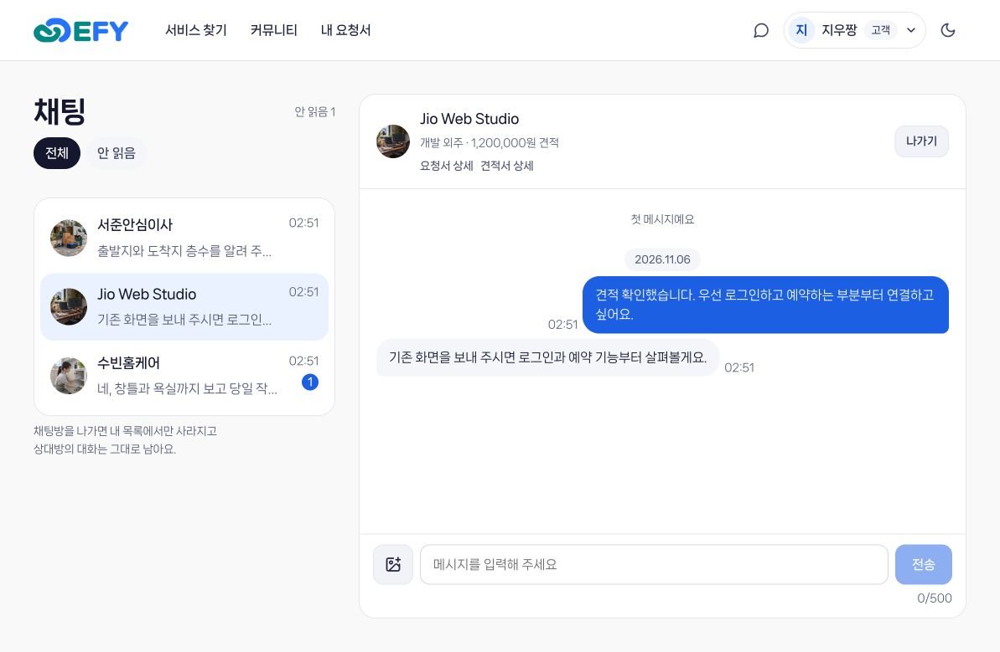
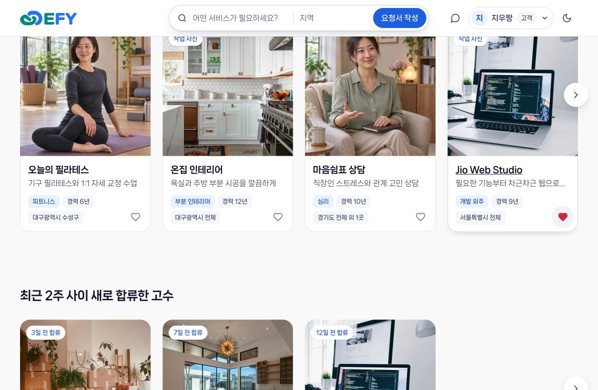
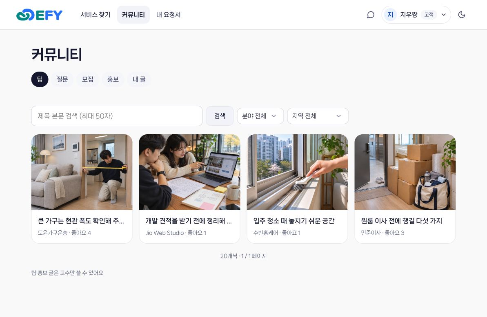
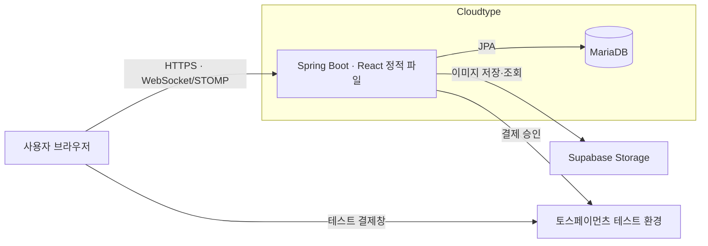

<!--suppress HtmlDeprecatedAttribute -->

# EFY

### Experts for you

**일상에 필요한 도움, 믿고 맡길 전문가를 바로 만나보세요.**

일반 사용자와 고수가 견적 요청과 제안을 통해 만나는 일상 서비스 매칭 플랫폼

2026.10.26 – 2026.11.06 · 백엔드 개발자 5인 팀 프로젝트

 

<table align="center">
  <tr>
    <th align="center" width="20%">이현정 · 팀장</th>
    <th align="center" width="20%">김태민</th>
    <th align="center" width="20%">김지웅</th>
    <th align="center" width="20%">박건웅</th>
    <th align="center" width="20%">김영서</th>
  </tr>
  <tr>
    <td align="center"></td>
    <td align="center"></td>
    <td align="center"></td>
    <td align="center"></td>
    <td align="center"></td>
  </tr>
  <tr>
    <td align="center"><a href="https://github.com/bam090">@bam090</a></td>
    <td align="center"><a href="https://github.com/qkdtkd77">@qkdtkd77</a></td>
    <td align="center"><a href="https://github.com/j-woong">@j-woong</a></td>
    <td align="center"><a href="https://github.com/pgw2001">@pgw2001</a></td>
    <td align="center"><a href="https://github.com/Luvys99">@Luvys99</a></td>
  </tr>
</table>

 

[배포 사이트](https://port-0-efy-api-mw1zsbylfe8cd41c.sel3.cloudtype.app) ·
[프로젝트 문서](https://app.notion.com/p/3f942d9a1d1880dbaa98e9d0c85e377f) ·
[요구사항 명세서](https://app.notion.com/p/de442d9a1d1882ac85d901a68f007fa6) ·
[API 명세서](https://app.notion.com/p/8d342d9a1d188283955b81b70bfc58af) ·
[ERD](https://app.notion.com/p/40042d9a1d18807a96fcc32f2d425820)

---

## 프로젝트 소개

EFY는 이사·과외 등 일상에 필요한 서비스를 제공하는 전문가와 사용자를 연결하는 플랫폼입니다. 
사용자는 견적을 요청하고, 제안받은 견적을 비교해 자신에게 맞는 전문가를 선택할 수 있습니다. 
전문가는 커뮤니티에서 노하우를 공유하고 자신의 서비스를 홍보할 수 있습니다.  
팀은 백엔드 구현에 집중하며, 데스크톱·모바일 프론트엔드는 AI를 활용해 제작했습니다.

**요청서 작성 → 견적 발송·비교 → 의뢰 요청 → 실시간 채팅**

## 주요 화면

<table>
  <tr><th width="33%">홈</th><th width="33%">요청서 작성</th><th width="33%">받은 견적서 목록</th></tr>
  <tr>
    <td valign="top"></td>
    <td valign="top"></td>
    <td valign="top"></td>
  </tr>
  <tr><th width="33%">채팅</th><th width="33%">활동 중인 고수 찜</th><th width="33%">커뮤니티</th></tr>
  <tr>
    <td valign="top"></td>
    <td valign="top"></td>
    <td valign="top"></td>
  </tr>
</table>

## 주요 기능

- **회원·인증**: 회원가입·로그인, JWT 인증·재발급·로그아웃, USER·EXPERT 역할 전환, 관리자 회원 관리
- **기준 데이터**: 카테고리·지역 공개 조회 및 관리자 등록·수정·삭제
- **고수 프로필**: 등록·수정·공개 조회, 활동 지역·제공 서비스, 작업 사진
- **견적**: 요청서 작성·취소, 조건에 맞는 고수에게 노출, 견적 발송·회수·만료, 의뢰 요청
- **채팅**: WebSocket(STOMP) 실시간 메시지·사진, 안 읽음 수, 읽음 처리, 나가기
- **커뮤니티**: 고수 노하우·고수에게 묻다 게시글·댓글, 좋아요, 관리자 공개 여부 관리
- **크레딧·결제**: 토스 테스트 결제 충전, 견적 발송 시 크레딧 예약·의뢰 요청 시 차감·만료 시 해제, 충전·사용 내역

## 시스템 아키텍처

React 프론트엔드를 Docker에서 빌드해 Spring Boot에 포함합니다. 브라우저는 같은 배포 주소에서 화면을 열고 API와 실시간 채팅에 연결합니다.

## 기술 스택

| 구분           | 기술                          |
|----------------|-------------------------------|
| 언어           | Java 25                       |
| 프레임워크     | Spring Boot 4.1.2, Spring MVC |
| 인증·인가      | Spring Security, JWT          |
| 데이터 접근    | Spring Data JPA               |
| 데이터베이스   | H2(로컬), MariaDB(배포)       |
| API 문서       | springdoc-openapi, Swagger UI |
| 빌드·개발 도구 | Gradle, Lombok, MapStruct     |
| 실시간 통신    | WebSocket, STOMP              |
| 외부 연동      | Toss Payments(테스트), Supabase Storage |
| 프론트엔드     | React 18, TypeScript, Vite (AI 활용 제작) |
| 배포           | Docker, CloudType             |

## 담당 범위

| 담당   | 영역                  | 구현 범위                                                     |
|--------|-----------------------|---------------------------------------------------------------|
| 이현정 | 회원·인증·기준 데이터 | 회원 관리, JWT, 카테고리·지역, 공통 설정                      |
| 이현정 | 고수 프로필           | 고수 등록·조회·수정, 활동 지역·제공 서비스 연결               |
| 김태민 | 견적 요청·매칭        | 고객 요청, 조건에 맞는 고수 조회, 견적서 발송·선택, 완료 처리 |
| 김영서 | 채팅                  | WebSocket 연결, 채팅방·참여자·메시지, 대화 조회               |
| 박건웅 | 커뮤니티              | 고수 노하우·고수에게 묻다, 게시글·댓글                   |
| 박건웅 | 반응                  | 고수 찜, 게시글·댓글 좋아요                              |
| 김지웅 | 크레딧·결제           | 토스 테스트 결제(주문·승인·실패 기록), 충전 상품, 견적 크레딧 예약·차감·해제, 잔액·사용 가능 크레딧, 충전·사용 내역 |

## 협업 방식

- `main`: 배포용 브랜치
- `dev`: 기능 통합 브랜치
- 기능 브랜치: `dev`에서 생성하며 `<type>/<이슈번호>-<기능명>` 형식 사용
- 작업 완료 후 `dev` 대상으로 PR을 작성하고 Squash and merge로 병합
- PR 본문에 `Closes #이슈번호`를 작성해 이슈 연결

[코드 컨벤션](https://app.notion.com/p/d7942d9a1d1883e9b3d7816f1343598c) · [테스트 및 이슈](https://app.notion.com/p/0fb42d9a1d1883d09800019f804d1c65)

[로컬 개발 안내](docs/local-development.md) · [프론트엔드 개발 문서](frontend/README.md)
